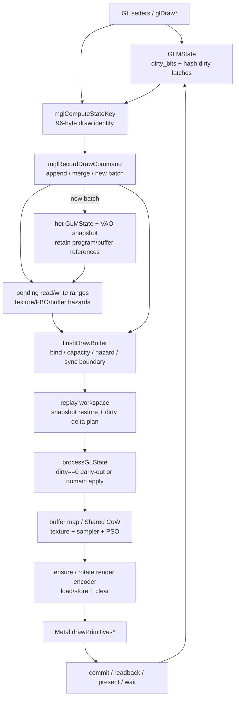

# MGL 全链路性能审查与落地 TODO

> - 基线：`main@7c9899d47aac838fc425293d39323f88302f7154`
> - 审查窗口：2026-11-21 至 2026-11-26
> - 范围：Dirty、Hazard、Batch、GL 状态机，以及它们与 Metal encoder、资源生命周期、PSO、present/readback 的交界。
> - 性质：源码静态审查 + 前次当前-main 实测/GPU trace 的复核 + 本轮静态门禁；不是仅凭历史文档作出的热点清单。

## 0. 阅读约定

| 标记 | 含义 | 能支持的结论 |
|---|---|---|
| **[S]** | 当前 revision 源码证据 | 当前代码如何执行、已有何种护栏 |
| **[R]** | 当前 revision 运行期计数或墙钟 | 指定负载上发生了什么；不可自动外推到真实游戏 |
| **[T]** | 当前 revision Metal GPU trace | command buffer、encoder、draw、附件动作 |
| **[H]** | 历史提交或历史文档 | 已有试验与风险；不是当前 main 的现状 |
| **[HYP]** | 尚未实测的假设 | 只能形成实验 TODO，不能写成确定收益 |

### 0.1 版本边界

以下提交**不是当前 main 的祖先**，不得描述为当前能力：

- `0923a575`：AIR fast-math 扩展试验；
- `b2f4629d` / `21bd231e`：deferred-clear 与默认关闭修复；
- `ad18048f` / `413436e1`：激进 DontCare 与默认关闭修复；
- `fc307630`：in-place snapshot replay；
- `46d30a15`：回退上述性能省略以隔离 CTS 崩溃；
- `f966ffb7`：历史交接文档使用的 HEAD。

当前 main 已有 `4d82401c`：跨帧颜色内容必须保留，不能用“本帧第一次作为 RT 使用”推断可丢弃旧内容。这是所有 LoadAction 优化的硬前提。

### 0.2 本轮复核状态

本轮在 Devin VM 上复核了关键源码路径，并通过：

- `scripts/state_machine_invariants.py`；
- `scripts/state_dataflow_coverage.py`；
- `scripts/check_layering.py`；
- `scripts/check_c_duplicates.py`。

`make -j4` 在本机未完成：LLVM 15 头文件缺失（`llvm/IR/Type.h` 等），因此本轮没有重新生成 benchmark 或 GPU trace。下文实测数字来自用户提供的上一轮同 revision 记录；所有性能收益仍需在当前环境重新 A/B。

## 1. 总判

1. **MGL 没有一个能代表所有负载的单一瓶颈。** Minecraft 提交型负载放大 record/replay、状态快照、小 buffer CoW 与 hazard 记录；IDK 形多 pass 负载同时还被片元 shader、FBO 轮换和附件 Load 支配。[R][T]
2. **`processGLState` 的 `dirty_bits==0` 快路径存在且有效，但只覆盖即时 draw 稳定段。** 延迟 replay 会主动重建 dirty 域；“GL 状态没变化”不等于“batch replay 没有状态成本”。[S]
3. **当前第一优先级不是继续加 setter micro-cache，而是修正观测口径。** PERF 已能抓到大量结构性事件，但输出粘连、dirty-hash 计数不透出、CoW 事件与真实 allocation 混在一个计数、present/commit 没有阶段耗时。[S]
4. **小 Shared buffer 的 dirty-upload CoW 是确认的 CPU/驱动热点，但现有 PERF 不能直接证明每次 CoW 都新分配。** `takeBufferCowSnapshot` 已有每 owner 8 slot pool 与 GPU completion generation；需要先拆分 event/pool-hit/newBuffer，再优化 pool/ring。[S][R]
5. **Batch 快照成本在离线提交支架上已成为主成本之一。** 每帧写入 20,557,200 字节热快照；353 个 stream batch 各只含 1 个 stream draw，创建期 snapshot share 为 0。[R]
6. **353 个单 draw stream batch 不是 append 失效。** 它们是 texture/program 状态切换的确定结果；其中纯纹理变化部分可接入现有 dynamic-direct，program 轮换部分不能借此消失。[S][R]
7. **clear-only pass 是 trace 直接证明的浪费，但不能简单恢复历史开关。** 一个 0-draw Clear/Store pass 后立即对同附件开 Load/Store draw pass；合并必须枚举 readback、copy/blit、sync、present 与 attachment 边界。[T][H]
8. **IDK 形负载必须同时处理 GPU 数学成本与提交支架。** 当前 main 离屏墙钟 33.893 ms，跳过 lighting 后 12.378 ms，全 draw 关闭仍 6.581 ms；Dirty/Batch 无法解释全部差距。[R]

## 2. 全链路现状图



关键源码锚点：

| 环节 | 当前实现 |
|---|---|
| Draw API | `MGL/src/L2_encode/draw_buffers.c:2069-2087` |
| Draw identity / hash cache | `MGL/src/L2_encode/mgl_draw_state_key.c:457-653` |
| 普通 batch 快照 | `MGL/src/L2_encode/draw_command.c:495-546` |
| Stream batch 快照 | `MGL/src/L2_encode/mgl_draw_stream_merge.c:1454-1525` |
| Stream demotion / dynamic merge | `MGL/src/L2_encode/draw_command.c:882-1002` |
| Replay 恢复 | `MGL/src/L2_encode/mgl_batch_flush_restore_encode.c:315-388` |
| 即时快路径 | `MGL/src/L2_encode/mgl_render_pass_process_swap.c:692-698` |
| FBO 匹配与轮换 | `MGL/src/L2_encode/mgl_render_pass_sync_ops.c:373-447` |
| Load/Store 计划入口 | `MGL/src/L2_encode/mgl_render_encoder_ops.c:708-769` |
| 即时 clear encoder | `MGL/src/L2_encode/mgl_clear_buffer_ops.c:1022-1070` |
| Shared dirty buffer CoW | `MGL/src/L1_backend/mgl_render_buffer.cpp:828-944` |
| CoW pool / GPU generation | `MGL/src/L1_backend/mgl_render_internal.h:454-508`、`:532-599` |
| PERF 汇总 | `MGL/src/L0_platform/mgl_frame_activity.c:223-314` |
| swap/present/commit | `MGL/src/L2_encode/mgl_render_pass_process_swap.c:1560-1732` |

## 3. 实测基线

### 3.1 环境与测量原则

上一轮同 revision 测量环境：Apple M4、macOS 27.2.1、Apple clang 21.0.0、Xcode 27.0 SDK；`DYLD_LIBRARY_PATH=$PWD/build` 固定加载当前构建。墙钟以 `glFinish`、提交循环或 harness 自带统计为准，不使用 MGL 当前 `GL_TIME_ELAPSED` 做性能结论。

`MGL_PERF_SUMMARY_EVERY=1` 若未同时打开 `MGL_PERF_SUMMARY_UNSAFE_EVERY_FRAME=1`，实际仍被钳到每 30 帧一次。PERF 样本因此是 swap-window 采样，不是逐帧全集。

### 3.2 三种负载顶层对照

| 负载 | 当前 main 实测 | 对照/消融 | 主要含义 |
|---|---:|---:|---|
| `mgl_benchmark --test minecraft-cpu` | P50 4.569 ms，219.1 FPS | — | 1216 draw/帧，但只形成 3 个 batch，属于较少 FBO/flush 的视觉支架 |
| `mc_offline_harness` submit-only | 平均 7.923 ms，P50 7.892 ms | 系统 GL 平均 0.998 ms，P50 0.994 ms | 同调用流、1384 draw/帧，突出 CPU 提交/记录/replay 成本 |
| IDK 形负载，离屏、每 4 帧 drain | MGL 33.893 ms | 系统 GL 8.191 ms | GPU 数学与多 pass 支架共同主导 |
| IDK 形负载，跳过 lighting | MGL 12.378 ms | 完整 33.893 ms | lighting 增量约 21.5 ms，是最大单项 GPU 成本 |
| IDK 形负载，全部 draw 关闭 | MGL 6.581 ms | 系统 GL 历史同形约 0.62 ms，未在本轮重测 | 无 draw 仍有明显支架成本；历史对照仅参考 |

`--repeat 4` 下单帧 p50 会混入未 drain 的短帧；IDK 对照采用 100 帧平均墙钟。

### 3.3 Minecraft 视觉支架

`build/mgl_benchmark --test minecraft-cpu --frames 120 --warmup 20` 稳态 PERF：

| 指标 | 每帧值 |
|---|---:|
| Draw | 1216 direct |
| Batch | 3 direct |
| Encoder | 2 new，0 FBO rotation |
| Flush | 0 |
| Snapshot | 166,680 bytes / 3 allocations，即 55,560 bytes/batch |
| Shared CoW event | 1 次，311,296 bytes |
| Vertex-buffer bind | 2361 calls，29,278 skips |
| Fragment-buffer bind | 28 calls，31,360 skips |
| Hazard | 3648 active-binding visits，1242 range visits |
| Stream merge | 0/3 prepare 成功；1213 次 sticky negative hit |
| Replay | 3 batches，2 次 delta narrow，0 次 same-key skip |

墙钟拆解同为 P50：CPU Submit 1.845 ms、Swap 2.714 ms、整帧 4.569 ms。**Swap 大于 Submit**，后续必须把 drawable acquire、present、commit、next drawable/new CB 分别计时，不能只优化 draw record。

### 3.4 Minecraft 离线提交支架

`HARNESS_SUBMIT_ONLY=1 HARNESS_FRAMES=120 HARNESS_WARMUP=20`：

| 指标 | MGL 每帧稳态样本 |
|---|---:|
| Draw | 1384 = 1031 direct + 353 stream-merged |
| Batch | 370 = 17 direct + 353 stream |
| Snapshot | **20,557,200 bytes / 370 copies；0 share hits** |
| Shared CoW event | **706 次，总计 67,776 bytes，平均 96 bytes/次** |
| Encoder | 8 new，6 FBO rotation |
| Flush | 3 total；原因计数含 2 bindBuf、2 capacity，非互斥 |
| Stream merge | 1384/1384 prepare 成功，1031 demote 到 direct |
| Replay | 370 batches，363 delta narrow，0 same-key skip |
| Delta 域 | 362 次 `rsUboOnly`，115 program、366 VAO、237 texture |
| Metal binding | 2836 VB calls / 8450 skips；1423 FB calls / 9207 skips |
| LoadAction | 12 Load、4 Clear、0 DontCare |

解读：

- 20.6 MB 是热状态与 VAO **拷贝字节数**，不是堆净增长；arena 会承接默认分配。
- 706 是 CoW event 数，不等于 706 次 `newBuffer`；但采样确实观察到 `newBuffer → IOGPUResourceCreate → mach_msg2_trap`，所以 allocation 仍需单独计数与归因。
- 353 个 stream batch 可精确分解为 224 个 entity、112 个 translucent、12 个 GUI atlas 组首、5 个 sky/terrain/cloud 组首；不是 4 MiB append 上限或普遍 append 失败。[S]
- 1031 次 demotion 分解为 sky 23、terrain 893、cloud 31、GUI 后续 84，并形成 17 个 direct batch。普通 exact/UBO donor sharing 已落地；stream snapshot 因 patched transient VBO/EBO 不能作为普通 donor。[S]
- `mglStateKeysEqualIgnoringUniformElementAndTextures` 已存在但没有调用点；配合 fail-closed 的 per-command dynamic capture，可把“只差纹理身份”的候选转入 dynamic-direct。[S]
- `rsUboOnly` 高而 same-key skip 为 0，符合每 draw UBO slice 改变导致 key 不完全相同；不能用 363 次 delta narrow 证明创建期 snapshot 已去重。

Harness JSON 报告 `gl_errors=0`，每帧使用 1384 个 UBO slice、ring 共 1400 slice（358,400 bytes），几乎每帧绕完整个 UBO ring；任何 CoW/ring 优化都必须按 GL buffer 身份与 GPU 在读代数归因。

### 3.5 IDK 形多 pass 负载

离屏完整负载 33.893 ms。另一个每帧 present 的运行只用于采集 PERF 结构：

| 指标 | 每帧值 |
|---|---:|
| Draw / batch | 14 / 14 |
| Encoder | 20 new，其中 13 FBO rotation |
| Encoder 原因 | 13 FBO、6 clear、1 VAO |
| Flush | 13 total |
| Snapshot | 777,840 bytes / 14 copies |
| LoadAction | 50 Load、6 Clear、0 DontCare |
| Metal binding | 359 VB、324 FB calls |
| Shared CoW event | 0 |

flush、FBO rotation、encoder creation 是三个不同事件，不能互相替代。50 次 Load 是附件槽位动作计数，不是 50 个完整 pass。此负载 CoW 为 0，因此不能把 Minecraft 的 CoW 优化直接宣称为 IDK 的解药。

### 3.6 GPU trace：空 clear pass 与同附件重载

缩小后的 Minecraft 视觉负载：2 个测量帧、160 draw/帧。trace 总计 3 个 command buffer、6 个 render encoder、322 个 draw；第三个 command buffer 为 0 encoder。

每个测量帧呈现：

1. `re0`：**0 draw**；离屏 color0 与 depth 都是 `LoadActionClear / StoreActionStore`。
2. `re1`：**160 draw**；同一 color0 与 depth 都是 `LoadActionLoad / StoreActionStore`。
3. `re2`：1 draw；到 `CAMetalLayer` drawable 的 `mgl_scaled_blit_vs/fs`，color0 为 `Load / Store`。

这证明至少存在一类可攻克的 pass 结构：clear 被单独物化，随后同附件重新 Load 才绘制。它不证明所有 FBO 都能合并，也不证明 scaled-blit 一定可删。

### 3.7 CPU 采样与微基准边界

3 秒 `sample` 直接观察到：

```text
mglRenderUpdateDirtyBuffer
  → mglRenderSnapshotSharedDirtyBuffer
  → takeBufferCowSnapshot
  → AGX newBuffer
  → IOGPUResourceCreate
  → IOConnectCallMethod
  → mach_msg2_trap
```

同时还观察到 replay dirty-domain apply、pipeline descriptor 生成、binding map。采样覆盖 warmup 与测量段，故只作为调用链证据，不换算成整帧百分比。

同一 `mgl_benchmark` 的 MGL／系统 GL 微基准显示：简单 setter 多数已是 ns 级；MGL 的 deferred draw、buffer/texture CPU upload 在部分微基准中甚至更快。这些数值不能当成端到端 GPU 上传或渲染 superiority；其价值是否定“所有 GL API 入口都天然慢”的泛化结论。

## 4. 子系统审查结论

### 4.1 Dirty

需要区分四套状态：

1. `GLMState.dirty_bits`：renderer 消费域；
2. `texture_dirty` / `vertex_layout_dirty` / `render_state_dirty` / `uniform_buffer_dirty`：draw-key hash 重算 latch；
3. FBO/attachment 自己的 binding/content dirty；
4. replay 为当前 batch 重新构造的 dirty 域。

`mglComputeStateKey` 已按 dirty latch 缓存四类 hash，并有 debug oracle。即时路径在 `dirty_bits==0` 且 encoder 有效时直接返回。剩余工作必须指出具体重复扫描、过度失效或 replay 放大的域，不能笼统提出“再加 dirty 检查”。

### 4.2 Hazard

两类成本必须分开：

- **记录成本**：每 draw 的 active binding 与 read-range 记录，即使最终没有 flush；
- **打断成本**：buffer/texture hazard、BindTexture/BindBuffer、capacity、overflow、同步读取导致的 flush/commit/pass 结束。

当前已有 active-mask、bucket、range cache、O(1) texture membership、program-aware texture read guard、flush-and-continue overflow。任何进一步收窄都必须保持 GL 顺序、反馈保护与 CPU 可见性，不得只凭“这次没有出错”删除 hazard。

### 4.3 Batch

Batch 成本不能只看 draw/batch 平均值，需要拆成 key 计算、候选比较、snapshot 写入、arena、retain、stream 数据展开、flush workspace 恢复、dirty 重建、Metal rebind、每 batch draw 数和提前 flush 原因。

本轮数据说明普通视觉支架、离线提交支架、IDK 多 pass 支架的 batch 形态完全不同；优化验收必须分别报告。

### 4.4 状态机

本轮静态护栏通过：16 个 key 字段均写入、96-byte key 无内部 padding、dirty-bit 数值单一来源、hot-copy 边界有静态断言、replay 的 active-state 切换符合约束、dataflow 没有新增未覆盖字段。

后续重点不是推倒重来，而是降低 replay 为证明状态一致性付出的固定成本，并让 key、snapshot、dirty delta、Metal binding cache 使用一致且可观测的状态语义。

### 4.5 按实测签名选择优化

| 实测签名 | 第一优先检查 | 不应先做什么 |
|---|---|---|
| `bufCow n` 高、平均 bytes 小，采样进入 IOGPU 分配 | Shared 小 buffer 生命周期、pool hit/miss、在读代数 | 只优化 memcpy 或盲目扩大单块 buffer |
| `snapshot bytes` 高，stream batch 常为单 draw，且 texture hash 改变 | PERF-B01 texture-tolerant dynamic-direct | 共享 patched stream snapshot |
| draw 数少但 encoder/new、fboRot、Load 数高 | FBO/clear/pass 组织、附件动作与 true hazard 分界 | 继续加 GL setter micro-cache |
| 跳过 lighting 后墙钟大幅下降 | shader 数学、UBO 地址空间与 GPU 代码生成 | 声称 Batch/Dirty 能解释全部帧时 |
| CPU Submit 不高但 Swap 占比大 | drawable 获取、present、commit、等待和 scaled-blit | 把全部帧时记到 draw record |
| `flush bindTex/war/bufR` 高 | 资源真实读写交集与 false positive | 全局关闭 hazard 或一律 flush-and-continue |
| `pipeline miss` 只在冷启动高 | PSO 预热、binary archive、首次使用分布 | 用稳态 cache hit 推导冷启动无问题 |

## 5. TODO 总表

优先级：P0 = 先修测量/正确性前提；P1 = 当前证据支持优先落地；P2 = 需要小实验决定；P3 = 邻接或长期项。工作量 S/M/L/XL 是相对代码与验证成本。

| ID | 优先级 / 工作量 | 条目 | 主要负载 | 状态 |
|---|---|---|---|---|
| PERF-O01 | P0 / S | 修复 PERF 日志记录边界 | 全部 | 可直接落地 |
| PERF-O02 | P0 / S | 透出已有 dirty-hash 重算计数器 | Dirty/Batch | 可直接落地 |
| PERF-O03 | P0 / S | 标明统计窗口、单位与 CoW 语义 | 全部 | 可直接落地 |
| PERF-O04 | P0 / M | 拆分 present / commit / drawable / newCB 阶段耗时 | MC 视觉、真实游戏 | 需要先建设测量 |
| PERF-O05 | P0 / M | 拆分 CoW event、pool hit、newBuffer、bytes 与 GPU 生命周期 | MC 离线支架 | 需要先建设测量 |
| PERF-B01 | P1 / M | 将纯纹理变化的 stream 候选降级到 dynamic-direct | MC 离线支架、多纹理 entity/GUI | 源码路径已核实，待实现与 A/B |
| PERF-C01 | P1 / M | 小 Shared buffer CoW pool/ring 强化 | MC 离线支架 | 依赖 PERF-O05 |
| PERF-R01 | P1 / M | 让 replay snapshot 拷贝域与 dirty-delta 域一致 | 高 batch 数负载 | 需要精确正确性分析 |
| PERF-R02 | P2 / S-M | 扩展 same-key skip 的 key 语义或失败归因 | 高 batch 数负载 | 先观测，不直接放宽 |
| PERF-F01 | P2 / L | 合并 clear-only pass 与后续同附件 draw pass | MC 视觉/离屏 FBO | trace 支持，正确性边界未闭合 |
| PERF-F02 | P2 / M | 严格限定 DontCare / first-use 优化 | IDK、多 pass | 只能实验，不能默认开启 |
| PERF-H01 | P1 / M | Hazard 记录成本与 false-positive 归因 | 高 draw/高绑定负载 | 先补事件计数，再裁精度 |
| PERF-P01 | P0 / S-M | PSO descriptor/build 冷热成本计时与预热口径 | 冷启动、program 切换 | 测量缺口 |
| PERF-G01 | P2 / L | IDK lighting/shader 数学专项 | IDK 形负载 | GPU 侧最大单项，超出 Dirty/Batch |
| PERF-X01 | P3 / M | 验证最终 scaled-blit 是否可省或合并 | MC 视觉、真实游戏 | 证据不足 |

## 6. 详细 TODO

### PERF-O01：修复 PERF 日志记录边界

- **证据**：`MGL PERF`、`PERF2`–`PERF5` 与 `SLOW FRAME` 的 `fprintf` 格式串都没有换行；直接写 stderr 时各段会和后续日志粘连（`MGL/src/L0_platform/mgl_frame_activity.c:223-314`）。[S]
- **实施**：给 PERF、PERF2–PERF5 和 SLOW FRAME 的格式串末尾补 `\n`；保留字段顺序，仅修复记录边界。
- **验收**：每个 PERF 段独占一行；慢帧警告独占一行；不改变任何计数器或热路径行为。
- **风险/回退**：若外部工具依赖粘连文本，需要同步解析规则；按独立 `MGL PERF` 前缀解析更稳健。回退为单行恢复。

### PERF-O02：透出已有 dirty-hash 重算计数器

- **证据**：texture/vertex/render/uniform 四个 hash 重算计数器已定义并在 swap reset，但 `MGLPerfCounters` 无字段，`mglSnapshotPerfCounters` 不读取，打印函数不输出（`mgl_frame_activity.h:173-176`、`:352-459`、`:461-558`、`:600-603`）。[S]
- **实施**：在 `MGLPerfCounters` 增加四个 `uint64_t`，在 snapshot 中读取现有 atomics，并在 PERF2 或独立短段输出 `hash: tex=… vtx=… rs=… ubo=…`；复用现有 reset。
- **验收**：`MGL_PERF_SUMMARY` 输出包含四项；默认关闭时无新增输出；不增加新的热路径原子写点。
- **风险**：只补齐展示链路，不代表已验证各生产点分类完整。

### PERF-O03：标明统计窗口、单位与 CoW 语义

- **证据**：PERF 在每次 swap 后 snapshot+reset（`mgl_render_pass_process_swap.c:1718-1732`），打印的是最近一次 swap window；`snapshot bytes` 是热拷贝写字节，`allocCount` 在默认 arena 路径不是实际 `malloc` 数，`bufCow n` 目前是 CoW event 数而非必然新 allocation。[S]
- **实施**：首段增加 `window=since-last-swap`；字段改为或注释为 `snap.copyBytes/copyCount/sharedBatchHits`、`bufCow.events/bytes`、`flush.calls`；保留旧 key 时可追加固定单位说明。
- **验收**：日志可直接判断 PERF1–5 是最近一次 swap window，而非 30/60 帧累计；snapshot、CoW、flush、LoadAction 的单位无歧义。
- **风险**：字段改名可能影响现有日志采集；优先采用附加说明而非破坏性格式变化。

### PERF-O04：拆分 present / commit / drawable / newCB 阶段耗时

- **证据**：MC 视觉支架 P50 整帧 4.569 ms，其中 Submit 1.845 ms、Swap 2.714 ms；swap 路径目前只在 tracing 下记录总 elapsed，PERF 没有阶段分解（`mgl_render_pass_process_swap.c:1560-1732`）。[S][R]
- **实施**：仅在 `MGL_PERF_SUMMARY` 开启时计时并累计：drawable acquire/复用、scaled-blit/copy、present call、commit、prefetch/nextDrawable、post-swap newCommandBuffer。避免逐帧 `clock_gettime` 无条件进入热路径；使用现有安全采样门。
- **测量**：同一 minecraft-cpu benchmark 的 submit/swap/frame P50 与新阶段计数；报告 capture on/off。
- **验收**：能判断 Swap 大头来自 drawable 等待、commit、present 还是 next drawable；关闭 PERF 时无新增显著开销。
- **风险**：阶段边界与异常 return 较多；所有 early exit 必须不计入错位阶段。

### PERF-O05：拆分 CoW event、pool hit、newBuffer、bytes 与 GPU 生命周期

- **证据**：`takeBufferCowSnapshot` 已有每 owner pool、最多 8 slots、`completed >= lastUseGeneration` 重用条件（`mgl_render_internal.h:454-508`），但 `mglRecordBufferCowSnapshot` 在每次 install 后都计数（`mgl_render_buffer.cpp:940-943`），无法分辨 reused 与 allocation。[S]
- **实施**：新增 `cow.events`、`cow.poolHits`、`cow.newBuffers`、`cow.newBufferBytes`、`cow.poolRejectedInFlight/length`；必要时按 size class 或 buffer byte-size bucket 汇总，不要按 GL name 打高基数日志。
- **验收**：同一 submit-only harness 能解释 706 次 event 中多少命中 pool、多少真正进入 `newBuffer`、多少因 in-flight/length 不匹配拒绝。
- **风险**：计数本身不能改变 generation stamping；新增字段必须保持 relaxed atomic 且只在 PERF 开启时更新。

### PERF-B01：将纯纹理变化的 stream 候选降级到 dynamic-direct

- **证据**：entity/GUI 纹理轮换使 texture hash 不同，现有 demotion 不成立，形成可避免的 stream 单 draw batch；`mglStateKeysEqualIgnoringUniformElementAndTextures` 已存在但无调用点；`mglCaptureDynamicDrawBindings` 与 replay per-command texture/VAO/UBO override 已存在，capture 失败拒绝合并。[S][R]
- **理论上限而非性能承诺**：若所有 dynamic capture 成功且其它规则不变，同一 harness 可从 370 个拥有型快照降到 126 个，snapshot 写入从 20,557,200 降到 7,000,560 bytes；112 个逐 draw 换 program 的 translucent batch 不消失。
- **实施**：
  1. 在 `draw_command.c:902-920` 的 `tolerant_equal` 判定中保留现有 UBO/vertex/element 分支；仅当 `mglBindNoFlushEnabled()` 为真时，增加 `mglStateKeysEqualIgnoringUniformElementAndTextures(...)` 兼容分支。
  2. 继续由 `draw_command.c:981-998` 的 `mglStateKeysEqualIgnoringDynamicBindings` + `mglCaptureDynamicDrawBindings` 做最终准入；capture 失败必须新建 direct batch。
  3. 保持 `mgl_draw_stream_merge.c:1470-1503` 的私有 snapshot patch 不变，不让 stream snapshot 注册普通 donor。
  4. program、pipeline、FBO、viewport/scissor、caps、primitive 与非 UBO render-state 必须继续严格相等；sampler、active-mask 或 capture 上限不兼容时 fail closed。
  5. `MGL_BIND_NO_FLUSH=0` 保留旧选择行为，便于 A/B 与回退。
- **测量**：同一 submit-only harness 记录 direct/stream draws 与 batches、snapshot bytes/copies/share hits、stream demotions、dynamic-capture rejection、draw skipped、wall P50/P95，以及 per-command dynamic texture apply/restore 成本。
- **验收**：仍提交 1384 个 draw，`draw_skipped=0`，entity/GUI 纹理、UBO 位置和像素输出一致；新增 A(texture0)→B(texture1)→A(texture0) 且每 draw 改 UBO range/VBO offset 的回归；sampler 不兼容、capture 超限、纹理删除/同名重建、VAO generation 变化均 fail closed；arena 开/关的 snapshot-share 测试通过。
- **风险/回退**：动态绑定可能把创建期成本转移到 replay；只有计数下降而 wall 不改善时不默认开启。回退只需移除 texture-tolerant demotion 分支。

### PERF-C01：小 Shared buffer CoW pool/ring 强化

- **证据**：离线支架 706 次 CoW event、平均 96 bytes；采样进入 `newBuffer → IOGPUResourceCreate → mach_msg2_trap`。当前 pool 已按 owner 最多 8 slots、以 command-buffer completion generation 判定可重用，且注释明确禁止 idle in-place fold，因为 skip-matched bind 可以不重新 stamp。[S][R]
- **前置**：先完成 PERF-O05，确认 allocation 与 pool miss 的真实比例；不能仅凭 CoW event 数优化。
- **实施方向**：
  1. 对 tiny buffers（例如 `<4096`）优先复用 size-class slots，而不是要求 `length <= slot.length` 的单一精确容量路径；
  2. 评估按 owner + size class 的小型 ring，slot 退役仍以 `lastUseGeneration`/`completed` 为硬条件；
  3. 对频繁全量重写的 buffer 考虑避免保留无用旧内容拷贝，但不得破坏 `glBufferSubData` 部分更新语义；
  4. 对 `gpu_write_target` 保持现有共享 store 特殊路径，不与普通 CoW 混用。
- **测量**：event/pool-hit/newBuffer、每次有效拷贝字节、提交 wall、GPU trace 中 buffer 生命周期、真实 Minecraft/支架 FPS。
- **验收**：任何 reused buffer 都必须晚于最后一次 encode 的 completed generation；`glBufferData/SubData/Map/Unmap`、skip-matched bind、多 commit 边界、buffer 删除/重建回归通过。
- **风险/回退**：过早复用会造成 GPU 读脏数据或画面撕裂；必须用 generation 测试和 stress loop，不得引入“通常已经完成”的启发式。回退为关闭 size-class/ring 扩展，保留现有严格 slot 逻辑。

### PERF-R01：让 replay snapshot 拷贝域与 dirty-delta 域一致

- **证据**：`mglBatchRestoreStateForBatch` 每个非 same-key batch 都先执行 hot-state compare-copy，再根据 prev/current key 缩小 dirty bits；UBO-ring-only 路径只跳过 volatile tail。离线支架 370 batches、363 delta narrow，但 snapshot restore 仍对应大量 memcpy。[S][R]
- **问题**：dirty delta 已知道某些域不变，但 snapshot copy 仍可能把该域写入 replay workspace；节省发生在 state apply，不完全发生在 copy。
- **实施**：按 hot region/domain 拆分 `mglCopyHotStateFieldsIfChanged*`；当 key delta 证明 program/texture/render-state 不变且 dynamic overrides 会覆盖 UBO/VAO/texture 时，只恢复必要 baseline 字段。保持 hash-table sync、dual-proxy 和 error redirect 不变。
- **测量**：`replay memcpy` bytes、每域 dirty counters、processGLState domain apply 次数、batch wall；确保 same-key skip 失败归因不受污染。
- **验收**：`test-state-snapshot-share`、batch replay、hazard、dirty-hash 与像素回归通过；arena 开/关一致；任何 dynamic capture 失败路径仍恢复完整状态。
- **风险**：key 不含全部 mutable state（例如 buffer content version）；不能把内容变化误判为 key 不变。所有跳过必须由 snapshot/dynamic override 所有权证明。

### PERF-R02：扩展 same-key skip 的 key 语义或失败归因

- **证据**：same-key skip 要求 encoder、bind cache、完整 key、absolute offsets、pass match 全部成立；离线支架 0 skip，同时 `rsUboOnly` 很高（`mgl_batch_restore.c:16-38`、`mgl_batch_flush_restore_encode.c:53-81`）。[S][R]
- **实施**：先输出 fail 原因的分布，再研究“忽略 UBO-only 差异的 skip”是否可由 dynamic uniform overrides 保证。不要直接放宽 `keys_equal`。
- **验收**：新增计数能区分 keyDiffer、bindInvalid、noEncoder、passMismatch、absoluteOffsetsMismatch、lastWasStream；任何放宽都必须有 per-command UBO override 与 pass match。
- **风险**：same-key skip 直接绕过 restore，错误合并会比多余 memcpy 更难诊断；只作为 P2 实验。

### PERF-F01：合并 clear-only pass 与后续同附件 draw pass

- **证据**：GPU trace 显示同一离屏 FBO 先有 0 draw Clear/Store pass，紧接着对同一 color/depth 附件开 Load/Store draw pass。源码中 unmasked immediate clear 会 end 当前 encoder、创建 `MGL_ENC_REASON_CLEAR` encoder、配置 LoadActionClear，然后立即 end（`mgl_clear_buffer_ops.c:1022-1070`）。[S][T]
- **实施方向**：
  1. 恢复/重做 deferred-clear 实验：unmasked、完整 attachment、无 scissor/mask 的 clear 先记录 pending bits，不物化 0-draw encoder；
  2. 下一次同 FBO draw pass 用 `LoadActionClear` 消费 pending bits；
  3. 任何 readback、copy/blit、mipmap、texture barrier、glFlush/finish/fence、present、FBO rebind、draw-buffer 改变、scissor/masked clear、attachment 替换都必须先物化或按顺序拆分；
  4. 多次 clear 同一附件要保留最后值与 GL 顺序，不同附件清除要独立消费。
- **测量**：GPU trace 中 encoder/pass 数、LoadAction 分布、clear encoder reuse/fallback、帧时；完整 CTS/regression 而非仅 MC。
- **验收**：trace 不再出现“0 draw Clear/Store → 同附件 Load/Store draw”的确定模式；像素、readback、跨帧保留、invalidate、MS depth/stencil 正确。
- **风险/回退**：历史 deferred-clear 默认关闭且不在 main；不能把历史 FPS 改善折算为当前收益。回退为保持 immediate clear encoder。

### PERF-F02：严格限定 DontCare / first-use 优化

- **证据**：`mglRenderPassPlanLoadStore` 目前只在 color、无 pending clear、`MGL_ENABLE_DONTCARE_LOAD`、texture present、`contents_undefined`、无 blend 时选择 DontCare；depth/stencil 默认 Load/Store（`mgl_render_pass_plan.c:204-243`）。`4d82401c` 要求跨帧颜色内容保留。[S]
- **实施**：仅允许在 attachment 内容被规范意义上的 undefined（例如 invalidate 后、首次分配且尚未被读、完整覆盖写且无 blend/read）时选 DontCare；不得以“本帧第一次作为 RT 使用”替代 lifetime 证明。
- **验收**：Load/DontCare 计数、像素回归、跨帧保留、invalidate、resize、MS/resolve 用例通过；历史激进 DontCare 不默认开启。
- **风险**：错误 DontCare 是视觉随机损坏，且可能只在特定时机出现；必须先做 CTS/回归，再考虑开关。

### PERF-H01：Hazard 记录成本与 false-positive 归因

- **证据**：当前已有 buffer range bucket chain、texture read/write open-address index、program-aware sampled-unit guard、overflow flush-and-continue（`mgl_draw_batch_hazard_track.c:333-377`、`:432-523`、`:530-569`、`:708-849`）。MC 视觉支架每帧仍有 3648 active-binding visits 与 1242 range visits。[S][R]
- **实施**：
  1. 增加每 draw 平均 visited entries、bucket chain 长度、range merge hit、overflow flush、flush trigger 的真实交集类型；
  2. 将 `bindTexture`、`bindBuffer`、`texW`、`bufR`、`war` 的触发点与 pending batch id 关联到低频 trace，不放进热日志；
  3. 对明显 false positive（例如未被当前 program 采样的 texture 仍触发）先修 mask/identity，不删 hazard。
- **测量**：PERF hazard counters、flush reason、wall；构造无真实重叠但同 buffer/texture 的负例与真实重叠正例。
- **验收**：真实 RAW/WAR/WAW 仍 flush；无交集 CPU write 不再触发；overflow 不 sticky-degrade，除非显式 `MGL_HAZARD_OVERFLOW_STICKY=1`。
- **风险**：hash-table degenerate path 当前保守返回 hit；任何 O(1) 优化都必须保留 fail-closed 行为。

### PERF-P01：PSO descriptor/build 冷热成本计时与预热口径

- **证据**：已有 pipeline cache hit/miss/eviction、PSO dedup hit/miss；`mgl_pso_build_ops.c` 另有 descriptor-state cache，但本地 `s_descriptorCacheHitCount` 不透出 PERF，且无 descriptor/PSO build 耗时。[S]
- **实施**：透出 descriptor cache hit/miss、PSO build wall、cache-hit path wall；benchmark 分 cold-start、warmup、steady-state 三段。
- **验收**：能判断冷启动 shader/PSO 成本是否影响真实游戏加载或首次进入维度；稳态 high hit 不再掩盖 cold miss。
- **风险**：不要把 shader compile wall 与 PSO build wall 重复计入同一 bucket。

### PERF-G01：IDK lighting/shader 数学专项

- **证据**：IDK 完整 33.893 ms，跳过 lighting 12.378 ms，增量约 21.5 ms；这是最大单项 GPU 成本，不是 Dirty/Batch 可解释的成本。[R]
- **实施**：单独审查 lighting shader 的 AIR/MSL 生成、fast-math 当前状态、UBO 地址空间、texture/shadow sampling、loop/unroll 与 register pressure；先在 Metal trace 中定位 pass 与 pipeline，再改编译器。
- **验收**：同 GPU/同分辨率/同 pass 数的 shader-only A/B；像素或数值容差明确；不把历史 fast-math 分支当作 main 能力。
- **风险**：fast-math 可能改变精度/NaN/Inf 行为；必须与 CTS 和视觉回归绑定。

### PERF-X01：验证最终 scaled-blit 是否可省或合并

- **证据**：GPU trace 每帧最后有 1 draw 的 scaled-blit 到 drawable；当前证据不足以判断它是否总是必要、是否可合并到前一个 pass 或用 blit/compute 替代。[T]
- **实施**：记录触发条件、输入/输出格式、尺寸、Y-flip、sRGB 与 drawable 大小；只在完全同尺寸同格式且无额外采样语义时尝试删除/合并。
- **验收**：窗口 resize、retina scaling、Y-flip、不同 pixel format、截屏/readback 路径均正确。
- **风险**：错误删除会直接影响所有可见输出；只作为 P3 邻接项。

## 7. 不建议直接实施的方向

- 不要把所有 flush 当成错误；正确性要求的 flush 必须保留。
- 不要把 `snapshot bytes` 当作堆泄漏或 Metal 分配字节。
- 不要把 `bufCow n` 直接当成 `newBuffer` 次数；当前代码已有 pool。
- 不要仅凭 draw 数判断 GPU-bound 或 CPU-bound。
- 不要把历史 fast-math、deferred-clear、DontCare、in-place-snapshot 当作当前 main 已有优化。
- 不要把 MGL 微基准中的 CPU 上传吞吐当成完整 GPU 可见传输时间。
- 不要使用当前 `GL_TIME_ELAPSED` 做优化验收。
- 不要再实现一套普通 direct batch exact/UBO donor sharing；当前 main 已有，0 share hits 是负载与 stream 准入的结果。
- 不要把 stream 的 `state_snapshot` / `vao_snapshot` 直接挂到普通 donor：其中已经写入 transient VBO/EBO 和 offset。
- 不要把 353 个单 draw stream batch 归因于 append 容量或初始化失败。
- 不要用 replay 的 `delta_narrow=363` 证明创建期 snapshot 已去重；它发生在恢复阶段。

## 8. 统一实验协议

每个性能 TODO 都必须做当前 revision 的 A/B，并至少覆盖：

1. `mc_offline_harness` submit-only：提交 CPU、hazard、snapshot、CoW。
2. `mgl_benchmark --test minecraft-cpu`：较多 draw、较少 flush 的视觉支架。
3. IDK 形负载：多 FBO、多附件、fullscreen/lighting GPU 成本。
4. `make test-all` 或适用完整回归；涉及 clear/load/store、hazard、buffer lifetime 时不能只跑单一 benchmark。
5. 涉及 Metal pass 结构时采集同形 GPU trace，核对 encoder 数、附件动作与 draw 数，而不只看墙钟。

报告必须写清 revision、环境开关、warmup、测量帧数、均值与 p50/p95、PERF 采样频率，以及是否开启 capture。开启逐帧打印或 GPU capture 的运行不能直接与不打印/不 capture 的运行比较墙钟。

## 9. 复现命令

```bash
make -j8
make bench bench-system mc-harness mc-harness-system
```

```bash
export DYLD_LIBRARY_PATH="$PWD/build"
MGL_PERF_SUMMARY=1 ./build/mgl_benchmark --test minecraft-cpu --frames 120 --warmup 20
```

```bash
export DYLD_LIBRARY_PATH="$PWD/build"
HARNESS_SUBMIT_ONLY=1 HARNESS_FRAMES=120 HARNESS_WARMUP=20 MGL_PERF_SUMMARY=1 ./build/mc_offline_harness
```

```bash
export DYLD_LIBRARY_PATH="$PWD/build"
HARNESS_SUBMIT_ONLY=1 HARNESS_FRAMES=120 HARNESS_WARMUP=20 ./build/mc_offline_harness_system
```

IDK 形负载源码位于原测量机的 gitignored `scratch/idk_bench/`，不是新克隆可获得的正式基准：

```bash
export DYLD_LIBRARY_PATH="$PWD/build"
./scratch/idk_bench/idk_bench_mgl --glsl 460 --noswap --no-timer --frames 100 --warmup 20 --width 1920 --height 1080 --instances 1024 --lights 64 --shadow 2048 --repeat 4
./scratch/idk_bench/idk_bench_sys --glsl 410 --noswap --no-timer --frames 100 --warmup 20 --width 1920 --height 1080 --instances 1024 --lights 64 --shadow 2048 --repeat 4
```

小型 GPU trace：

```bash
export DYLD_LIBRARY_PATH="$PWD/build"
MTL_CAPTURE_ENABLED=1 HARNESS_GPU_TRACE=/tmp/mc-small.gputrace HARNESS_FRAMES=2 HARNESS_WARMUP=1 HARNESS_WIDTH=640 HARNESS_HEIGHT=360 HARNESS_TERRAIN_DRAWS=64 HARNESS_ENTITY_DRAWS=16 HARNESS_GUI_DRAWS=16 ./build/mc_offline_harness
printf 'status\nlist\ngo commands\nlist\nexit --terminate\n' | gpudebug -t /tmp/mc-small.gputrace --oneshot --json
```

## 10. 尚未证明的事项

- 没有用真实 Prism/Minecraft 游戏进程重做本轮全量测量；离线支架结论必须在真实场景复验。
- 小型 GPU trace 只覆盖缩小后的 Minecraft 视觉负载，没有逐 pass 捕获完整 IDK 形负载。
- PERF-B01 尚未实现；126 次快照只是按当前选择规则推演的目标，不是优化后实测结果。
- 历史分支的 FPS 改善不能直接折算为当前 main 的收益；所有历史数据都需要同 revision A/B 重测。
- 本轮 Devin VM 缺少 LLVM 15 开发头，未重新构建/重跑 benchmark；这不改变源码审查结论，但所有性能验收必须在完整依赖环境执行。

## 附录 A：计数器与术语防误读

| 术语/计数 | 正确含义 | 不意味着什么 |
|---|---|---|
| `snapshot bytes` | 创建期实际执行的热 GLMState region + VAO 拷贝字节 | 堆净增长、Metal buffer 字节或 arena reserved 字节 |
| `snapshot allocation count` | 成功创建拥有型快照的次数 | 默认 arena 路径上的真实 `malloc` 次数 |
| `snapshot share hit` | 创建期复用 exact/UBO donor | replay 的 same-key Metal binding skip |
| `delta narrow` | replay 根据前后 key 缩小 dirty 恢复域 | 创建期 snapshot 去重 |
| `stream prepare ok` | 候选数据可读且通过结构检查 | 已 append 到既有 stream batch，或已形成多 draw batch |
| `stream demoted` | 为利用 tolerant/dynamic direct 合并而改变路径选择 | append 失败、draw 被丢弃或渲染错误 |
| `flush total` | pending batch 被整体送出的次数 | command buffer commit 次数或 render encoder 创建次数 |
| flush reason | 触发原因分类计数，可在同一边界出现多个原因 | 可直接相加得到 flush total 的互斥分桶 |
| `encoder new` | 新 Metal render encoder 创建 | 必然等于新 command buffer 数 |
| `fboRot` | FBO 驱动 encoder 轮换，是 encoder new 的子集 | 所有 flush 或所有 pass |
| Load/StoreAction 计数 | pass 创建时按附件槽位累计的动作 | 同数量的 draw 或完整 render pass |
| CoW count / bytes | Shared dirty buffer 快照事件与对应 buffer 字节 | 必然等于 newBuffer 次数、memcpy 字节或 GPU 带宽 |
| `same-key skip` | replay 间可复用已绑定 Metal 状态的跳过 | batch 创建期快照共享 |
